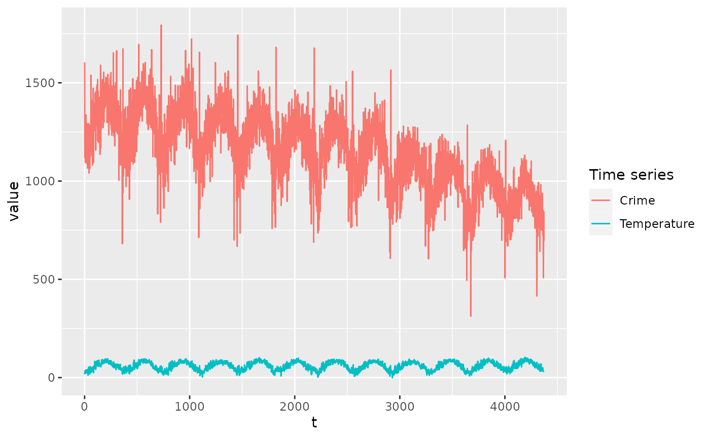
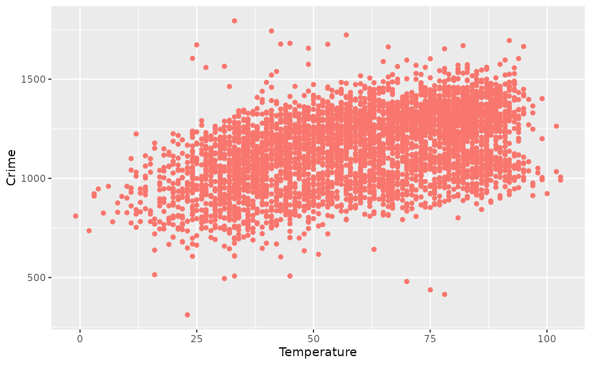
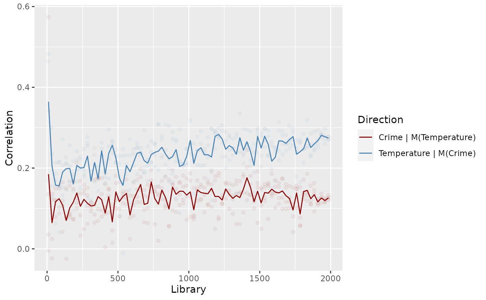

# Chicago crime/temperature example

## The data

To demonstrate the usefulness of EDM in estimating the impact of causal
variables, we use a real-world dataset that reflects daily temperature
and crime levels in Chicago, which we make available in the
[chicago.csv](https://edm-developers.github.io/fastEDM-r/articles/chicago.csv)
file.

First, we load the time series into R:

``` r
chicagoURL <- url("https://github.com/EDM-Developers/fastEDM-r/raw/main/vignettes/chicago.csv")
chicago <- read.csv(chicagoURL)
head(chicago)
#>   Time Temperature Crime
#> 1    1       24.08  1605
#> 2    2       19.04  1119
#> 3    3       28.04  1127
#> 4    4       30.02  1154
#> 5    5       35.96  1251
#> 6    6       33.08  1276
```

Plotting the two time series shows:

``` r
library(ggplot2)

df <- data.frame(list(
  t = rep(chicago$Time, 2),
  variable = c(rep("Crime", nrow(chicago)), rep("Temperature", nrow(chicago))),
  value = c(chicago$Crime, chicago$Temperature)
))

ggplot(df, aes(x = t)) +
  geom_line(aes(y = value, color = variable)) +
  labs(colour = "Time series")
```



When plotted as a scatter plot, there appears to be some linear
correlation between the variables:

``` r
ggplot(chicago, aes(x = Temperature, y = Crime)) +
  geom_point(color = "#F8766D")
```



Calculating the linear correlation between `Crime` and `Temperature`:

``` r
cor(chicago["Temperature"], chicago["Crime"])
#>                Crime
#> Temperature 0.461996
```

shows a mild correlation, however the causal structure (if any) and its
direction is not shown.

## Find the optimal embedding dimension

Now we use `edm` to find the optimal embedding dimension of the
`Temperature` time series. We check the values of $E = 2,\ldots 10$.

``` r
library(fastEDM)

# Suppress the progress bar in vignettes, as it confuses knitr.
formals(edm)$showProgressBar <- FALSE

res <- edm(chicago["Time"], chicago["Temperature"], E = 2:10, numThreads = 4)
#> Summary of predictions
#>    E library theta       rho      mae
#> 1  2    4362     1 0.8997859 7.082024
#> 2  3    4362     1 0.9072206 6.855183
#> 3  4    4362     1 0.9134127 6.612733
#> 4  5    4362     1 0.9168053 6.480270
#> 5  6    4362     1 0.9199294 6.421143
#> 6  7    4362     1 0.9209906 6.359446
#> 7  8    4362     1 0.9204720 6.396095
#> 8  9    4362     1 0.9199941 6.434616
#> 9 10    4362     1 0.9195183 6.470821
#> Number of neighbours (k) is set to between 3 and 11
```

From the `rho` column we can see that the prediction accuracy is
maximised when $E = 7$, so we take this as our estimate of the embedding
dimension.

## Convergent cross-mapping

The `edm` command can also run the cross-mapping task, which allows us
to ascertain the causal links between the crime and temperature time
series.

``` r
# Find the maximum library size for the dataset.
res <- edm(chicago["Time"], chicago["Temperature"],
  E = 7,
  full = TRUE, saveManifolds = TRUE, verbosity = 0
)
libraryMax <- nrow(res$Ms[[1]])

# Choose a linearly spaced grid of library sizes to evaluate the S-map algorithm on.
libs <- ceiling(seq(10, libraryMax, length.out = 25))

# Run the convergent cross-mapping in each causal direction.
crimePredictsTemp <- edm(chicago["Time"], chicago["Crime"], chicago["Temperature"],
  numReps = 2,
  algorithm = "smap", E = 7, library = libs, k = 100, numThreads = 4, verbosity = 0
)

tempPredictsCrime <- edm(chicago["Time"], chicago["Temperature"], chicago["Crime"],
  numReps = 2,
  algorithm = "smap", E = 7, library = libs, k = 100, numThreads = 4, verbosity = 0
)
```

**Note:** These last two lines are the most computationally demanding.
They may take a minute to finish. Choosing a machine with more CPU cores
or faster cores will help significantly.

Plotting the results gives:

``` r
tidyDF <- data.frame(list(
  Library = c(
    crimePredictsTemp$summary$library,
    tempPredictsCrime$summary$library
  ),
  Direction = c(
    rep("Temperature | M(Crime)", nrow(crimePredictsTemp$summary)),
    rep("Crime | M(Temperature)", nrow(tempPredictsCrime$summary))
  ),
  Correlation = c(
    crimePredictsTemp$summary$rho,
    tempPredictsCrime$summary$rho
  )
))

ggplot(tidyDF, aes(x = Library, y = Correlation)) +
  geom_line(aes(color = Direction)) +
  scale_color_manual(values = c("steelblue", "darkred")) +
  geom_point(data = tempPredictsCrime$stats, aes(x = library, y = rho), alpha = 0.05, color = "steelblue") +
  geom_point(data = crimePredictsTemp$stats, aes(x = library, y = rho), alpha = 0.05, color = "darkred")
```



In this plot, we can see that one direction shows a significant increase
in accuracy as $L$ increases, whereas the other direction is pretty
flat. The direction which increases the most is the
$\texttt{𝚃𝚎𝚖𝚙𝚎𝚛𝚊𝚝𝚞𝚛𝚎} \mid M\left( \texttt{𝙲𝚛𝚒𝚖𝚎} \right)$ direction.
This notation means we used $\texttt{𝙲𝚛𝚒𝚖𝚎}$ to predict
$\texttt{𝚃𝚎𝚖𝚙𝚎𝚛𝚊𝚝𝚞𝚛𝚎}$, and due to the backward nature of EDM means it
refers to the causal link
$\left. \texttt{𝚃𝚎𝚖𝚙𝚎𝚛𝚊𝚝𝚞𝚛𝚎}\rightarrow M\left( \texttt{𝙲𝚛𝚒𝚖𝚎} \right) \right.$.
Therefore, we’d conclude that there is a causal link from temperature to
crime, though no link in the reverse direction (which would be
implausible).
